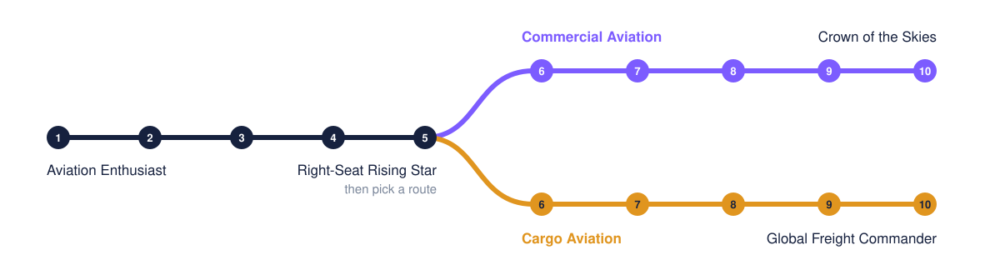

### Hi, I'm Szabolcs

At **[Elixify](https://elixify.hu)** I'm the person clients talk to. I take the first call, turn the brief into a plan, keep the team on schedule and check that what we ship is what was asked for. My day job is at Unisys Hungary.

After hours I make mods. The first one teaches a Sims 4 household to fly.

### Current routes

| Flight | Operator | What I do there | Status |
| :-- | :-- | :-- | :-- |
| `ELX` | [Elixify](https://elixify.hu) | Client relations and project management for websites, marketing and social media | Boarding |
| `UNI` | Unisys Hungary | Day job | Cruising |
| `CFT` | [Cleared for Takeoff](https://github.com/szabike/cleared-for-takeoff) | Sims 4 pilot career mod, built solo | Beta 0.1.0 |

### Cleared for Takeoff

A ten-level pilot career for The Sims 4. Your Sim starts with a clipboard at ground ops, and at level 5 picks passengers or freight.

It has 15 ranks, 13 chance cards with 52 outcomes, 7 daily prep tasks, overnight cargo shifts, and no dependencies beyond the base game. The build tooling is JavaScript and the in-game script is Python.

**[Read the career guide](https://github.com/szabike/cleared-for-takeoff/blob/main/CAREER-GUIDE.md)** or **[grab the files](https://github.com/szabike/cleared-for-takeoff)**.

### How a project flies with me

1. **Brief.** We talk through what you need and what done looks like.
2. **Flight plan.** You get scope, timeline and price in writing before anything starts.
3. **In the air.** Short check-ins at agreed points, so nothing is a surprise.
4. **Landing.** Launch, handover and a walkthrough of what you now own.

### Get in touch

Start a project at **[elixify.hu](https://elixify.hu)**, or open an issue on any of my repos.

Flying with [@Szabolcs05](https://github.com/Szabolcs05), who keeps the Elixify servers in the air.
