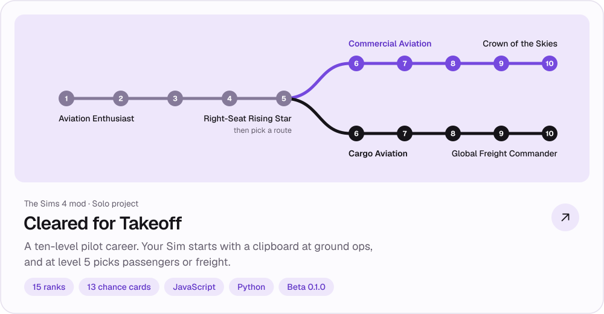

<h3></h3>

I'm Szabolcs, 21, based in Budapest. At **[Elixify](https://elixify.hu)** I'm the person clients talk to. I take the first call, turn the brief into a plan, keep the team on schedule and check that what we ship is what was asked for.

During the day I work in German-speaking first-level IT support at **Unisys**, helping the staff of a large restaurant chain when their hardware or software stops working. Before that I booked appointments and coordinated call campaigns at Konecta, and checked in deliveries at a DSV warehouse in Germany.

After hours I build mods. The first one teaches a Sims 4 household to fly.

**Languages:** Hungarian (native), German (C1), English (C1)

<h3></h3>

| When | Where | What |
| :-- | :-- | :-- |
| Now | [Elixify](https://elixify.hu) | Client relations and project management for websites, marketing and social media |
| Since Aug 2026 | Unisys Hungary | German-speaking first-level (L1) IT support |
| Feb to Aug 2026 | Konecta Hungária | Call center agent: customer acquisition, appointment booking, campaign coordination |
| Dec 2024 to Feb 2026 | DSV Solution GmbH, Möckmühl | Warehouse operator: goods-in checks, delivery paperwork, forklift |

<h3></h3>

It also has 7 daily prep tasks and overnight cargo shifts, and it needs nothing beyond the base game.

**[Download on CurseForge](https://www.curseforge.com/sims4/mods/cleared-for-takeoff-pilot-career)**, **[read the career guide](https://github.com/szabike/cleared-for-takeoff/blob/main/CAREER-GUIDE.md)** or **[browse the source](https://github.com/szabike/cleared-for-takeoff)**.

<h3></h3>

Every Elixify project starts with a short, 15-minute call. After that we go step by step.

1. **We talk through what you need.** We go into detail on what you want and how you picture it.
2. **You get a custom quote.** We email a quote for the agreed tasks. You read it, we answer your questions, and you accept by email.
3. **You meet the team.** You talk with the people who will work on your project, and we settle the details together.

<h3></h3>

A new website, more consistent marketing, or your own photos and videos? Tell me where you are now and what you want to achieve.

**[Book a 15-minute call](https://www.cal.eu/elixify/15-perc)** or visit **[elixify.hu](https://elixify.hu)**.

Also at Elixify: [@Szabolcs05](https://github.com/Szabolcs05).
